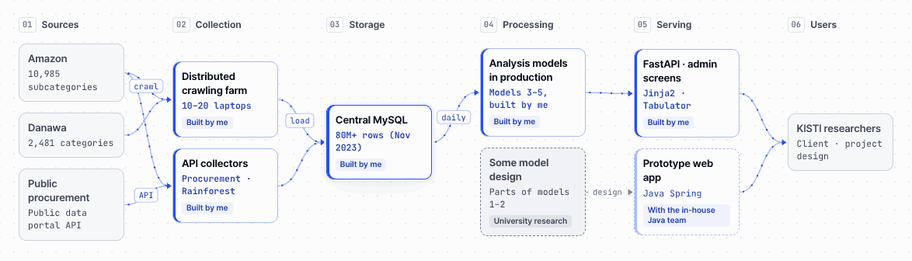
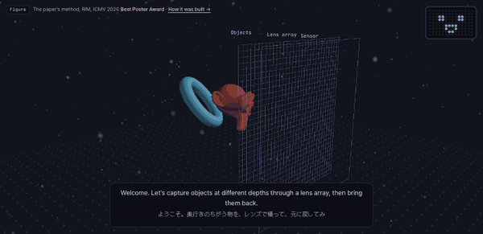
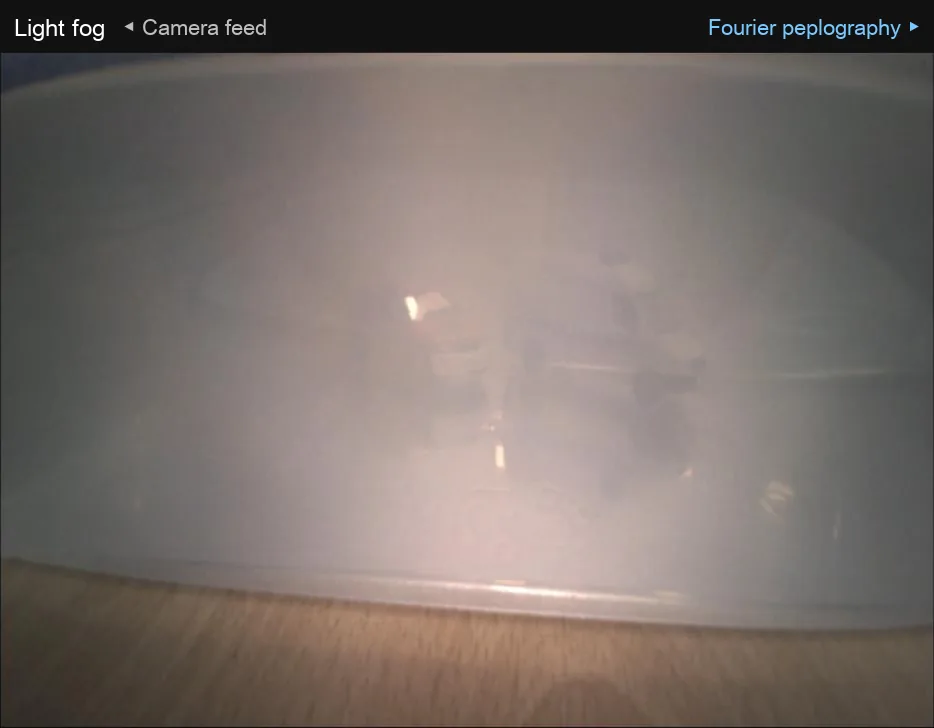

### Data & Backend Engineer · 3D Vision Researcher

I am Hyeongju Lee (**[CV](https://github.com/zoocasso/zoocasso/blob/main/cv_hyeongjulee.pdf)**), a data & backend engineer with 29 months of industry experience, now researching 3D vision as a master's student at Kyushu Institute of Technology. 
I build data pipelines end to end, from collection to serving, and turn research methods into working code. 
Graduating with a master's in March 2027. 
Project write-ups are on <b><a href="https://zoocasso.github.io">zoocasso.github.io</a></b>; the code is here.

 

 

The data systems I built, as drawn on my site: the KISTI project from collection to serving, with my own work in solid blue. Clicking a node highlights the path through it.

<table>
<tr>
<td width="50%" valign="top"> <b>Research:</b> a lens array lab in the browser that captures a scene and reconstructs it at any depth (RIM, ICMV 2026 Best Poster Award)</td>
<td width="50%" valign="top"> <b>XR headset:</b> fog removal and low-light recovery on the device's own camera, 2024 makerthon (team 3DOS, sole developer)</td>
</tr>
</table>

 

## Highlights

- **Data & backend, Vision Inside (2022–2024):** collection, loading and serving for a KISTI-commissioned R&D platform (80M+ rows), and the pipeline, backend and frontend of a genomic report system over ~1 TB of public references.
- **Research, Kyushu Institute of Technology (2025–):** training-free light-field / integral-imaging reconstruction with 4 first-author conference papers (ICMV 2026 Best Poster Award), and an image-data pipeline for joint research with Hitachi, deployed on site in the Netherlands.
- **Side project:** sole server developer of a community rhythm game, ~2,000 peak concurrent players, on AWS behind Cloudflare.

 

## Featured Projects

| Project | What it is | Stack | Write-up |
| :--- | :--- | :--- | :---: |
| KISTI data platform (company code, not public) | Collection, loading and serving for a KISTI public R&D platform designed by KISTI researchers: 80M+ rows from crawlers on 10–20 laptops, model batches and a FastAPI admin interface; DB schema, backend integration and frontend wiring for the Java Spring prototype web app (with the in-house Java team) | Python, Selenium, MySQL, FastAPI, Java Spring, KeyBERT | [details](https://zoocasso.github.io/en/work/kisti/) |
| Image-data pipeline, joint research with Hitachi (lab code, not public) | Written from scratch: machine-vision camera control (Spinnaker SDK / PySpin), capture, dataset preprocessing and a PyQt GUI for non-developer researchers; deployed on site in the Netherlands (Sep–Oct 2026) | Python, PySpin, PyQt | [details](https://zoocasso.github.io/en/work/hitachi/) |
| [bio_fastapi](https://github.com/zoocasso/bio_fastapi) | Genomic variant annotation & risk reports: genotypes joined to ~1 TB of public references in four SQL stages; JSON API and HTML viewer, tested on SQLite and MySQL 8.0/8.4 (Vision Inside, 2022–2023; pipeline algorithm designed with the team lead) | FastAPI, SQLAlchemy, MySQL, Docker | [details](https://zoocasso.github.io/en/work/genomics/) |
| [wjmax-game-server](https://github.com/zoocasso/wjmax-game-server) | Play-log ingestion API of a community rhythm game (2023–2024, ~2,000 peak concurrent players), as its sole server developer; the code here adds transactions, input validation, tests and CI | FastAPI, SQLAlchemy, MySQL, Docker, AWS, Cloudflare | [details](https://zoocasso.github.io/en/work/wjmax/) |
| [origin-point-optimization-vcr](https://github.com/zoocasso/origin-point-optimization-vcr) | Code for my ITC-CSCC 2025/2026 papers: origin point found from camera parameters, 81 reconstructions → 1 (paper: 0.31 s vs an estimated 25.45 s) | Python, NumPy, CuPy | [details](https://zoocasso.github.io/en/research/origin-point/) |
| [depth-estimation-using-vcr-algorithm-matlab](https://github.com/zoocasso/depth-estimation-using-vcr-algorithm-matlab) | 2022 course project where the research started: object depth from integral images, VCR at candidate depths + FFT correlation filters, built on the course's lecture scripts; tested in Octave | MATLAB, Octave | – |
| [realtime-vision-xr-device](https://github.com/zoocasso/realtime-vision-xr-device) | Fog removal and low-light recovery on an XR headset, 2024 XR Device Content Makerthon (team 3DOS: sole developer and stage demo; slides) | C++, OpenCV, Unity | – |

 

## Publications & Research

Write-ups on the site: [RIM and iRIM](https://zoocasso.github.io/en/research/rim/) · [Origin point optimization](https://zoocasso.github.io/en/research/origin-point/)

| Status | Conference | Paper Title |
| :---: | :--- | :--- |
| **Best Poster Award** | **ICMV 2026** | Angular-to-Spatial Information Redistribution via Ray-based Inverse Mapping |
| **Poster** | **ICCAS 2026** | Virtual Lens Array Synthesis from Multi-View Images via iRIM |
| **Presented** | **ITC-CSCC 2026** | Accelerated Origin Point Optimization for Volumetric Computational Reconstruction |
| **Presented** | **ITC-CSCC 2025** | Image Enhancement of Volumetric Computational Reconstruction Using Origin Point Optimization |

 

## Tech Stack

### **Data & Backend**
       

### **Computer Vision & Research**
   

### **Infrastructure**
    
