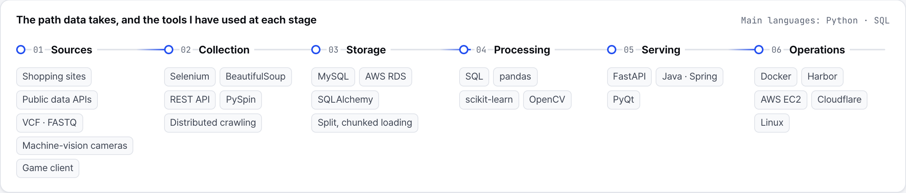
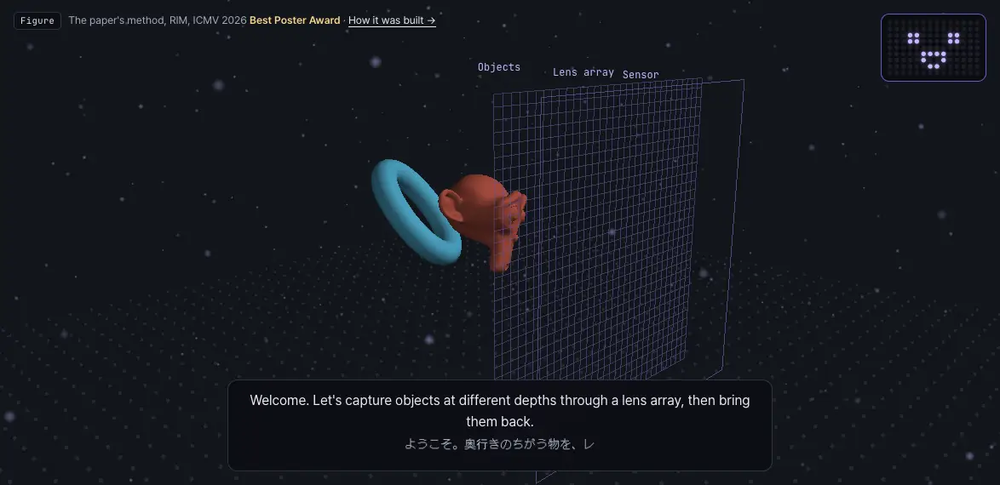
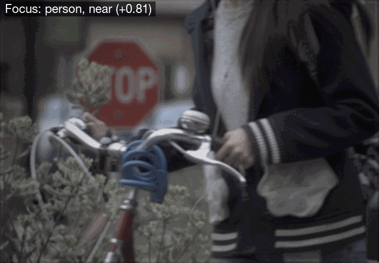
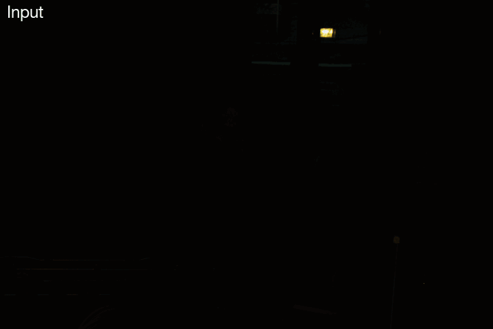

### Data & Backend Engineer · 3D Vision Researcher

I am Hyeongju Lee (**[CV](https://github.com/zoocasso/zoocasso/blob/main/cv_hyeongjulee.pdf)**), a data & backend engineer with 29 months of industry experience, now researching 3D vision as a master's student at Kyushu Institute of Technology. 
I build data pipelines end to end, from collection to serving, and turn research methods into working code. 
Graduating with a master's in March 2027. 
Project write-ups are on <b><a href="https://zoocasso.github.io">zoocasso.github.io</a></b>; the code is here.

 

 

**Data & backend** · from sources to operations

The systems I built follow this path; on my site each one is drawn stage by stage, with my own part marked.

 

**Research** · a lens array lab in the browser (RIM, ICMV 2026 Best Poster Award)

A scene is captured through a lens array and rebuilt at any depth; the lab on my site runs in the browser.

 

**Research** · real-time detection and depth on lens-array images (master's thesis, in preparation)

Detect once on a real Lytro frame, then refocus only inside each box on the GPU: 16.4 ms per frame (61 fps, RTX 3090). Scene: Stanford Lytro Light Field Archive, occlusions_25 (Raj et al., 2016).

 

**Research** · image enhancement for low-light and hazy scenes (an algorithm I developed)

Photos taken in the dark or in haze are made clear one image at a time; below, a dark photo from a public dataset. Data: SI-HDR (Hanji et al., SIGGRAPH 2022, CC BY 4.0).

 

## Highlights

- **Data & backend, Vision Inside (2022–2024):** collection, storage and serving for a KISTI-commissioned R&D platform designed by KISTI researchers, with models 3–5, which I built and put into production; and the pipeline, backend and frontend of a genomic report system (pipeline algorithm designed with the team lead).
- **Research, Kyushu Institute of Technology (2025–):** training-free light-field / integral-imaging reconstruction with 4 first-author conference papers (ICMV 2026 Best Poster Award), and an image-data pipeline for joint research with Hitachi, deployed on site in the Netherlands.
- **Master's thesis (in preparation):** real-time object detection and depth on lens-array images, 16.4 ms per frame on the GPU.
- **Image enhancement:** developed an image-enhancement algorithm for low-light and hazy scenes.
- **Side project:** owned the server, database and security of a community rhythm game, ~2,000 peak concurrent players, on AWS behind Cloudflare.
- **Scholarship:** Rotary Yoneyama Memorial Foundation Scholar (2026), selected through a Japanese-language interview.

 

## Featured Projects

| Project | What it is | Stack | Write-up |
| :--- | :--- | :--- | :---: |
| KISTI data platform (company code, not public) | Collection, loading and serving for a KISTI public R&D platform designed by KISTI researchers: data from a distributed crawling farm of laptops, model batches and a FastAPI admin interface; DB schema, backend integration and frontend wiring for the Java Spring prototype web app (with the in-house Java team) | Python, Selenium, MySQL, FastAPI, Java Spring, KeyBERT | [details](https://zoocasso.github.io/en/work/kisti/) |
| Image-data pipeline, joint research with Hitachi (lab code, not public) | Written from scratch: machine-vision camera control (Spinnaker SDK / PySpin), capture, dataset preprocessing and a PyQt GUI for non-developer researchers; deployed on site in the Netherlands (Sep–Oct 2026) | Python, PySpin, PyQt | [details](https://zoocasso.github.io/en/work/hitachi/) |
| [bio_fastapi](https://github.com/zoocasso/bio_fastapi) | Genomic variant annotation & risk reports: genotypes joined to public references in four SQL stages; JSON API and HTML viewer, tested on SQLite and MySQL 8.0/8.4 (Vision Inside, 2022–2023; pipeline algorithm designed with the team lead) | FastAPI, SQLAlchemy, MySQL, Docker | [details](https://zoocasso.github.io/en/work/genomics/) |
| [origin-point-optimization-vcr](https://github.com/zoocasso/origin-point-optimization-vcr) | Code for my ITC-CSCC 2025/2026 papers: origin point found from camera parameters, 81 reconstructions → 1 (paper: 0.31 s vs an estimated 25.45 s) | Python, NumPy, CuPy | [details](https://zoocasso.github.io/en/research/origin-point/) |
| [depth-estimation-using-vcr-algorithm-matlab](https://github.com/zoocasso/depth-estimation-using-vcr-algorithm-matlab) | 2022 course project where the research started: object depth from integral images, VCR at candidate depths + FFT correlation filters, built on the course's lecture scripts; tested in Octave | MATLAB, Octave | – |
| [realtime-vision-xr-device](https://github.com/zoocasso/realtime-vision-xr-device) | Fog removal and low-light recovery on an XR headset, 2024 XR Device Content Makerthon (team 3DOS: owned all development and the stage demo; slides) | C++, OpenCV, Unity | – |
| [wjmax-game-server](https://github.com/zoocasso/wjmax-game-server) | Play-log ingestion API of a community rhythm game (2023–2024, ~2,000 peak concurrent players), owning the server, database and security; the code here adds transactions, input validation, tests and CI | FastAPI, SQLAlchemy, MySQL, Docker, AWS, Cloudflare | [details](https://zoocasso.github.io/en/work/wjmax/) |

 

## Publications & Research

Write-ups on the site: [RIM and iRIM](https://zoocasso.github.io/en/research/rim/) · [Origin point optimization](https://zoocasso.github.io/en/research/origin-point/)

| Status | Venue | Paper Title |
| :---: | :--- | :--- |
| **In preparation** | **Master's thesis** | Real-time object detection and depth estimation on lens-array images (working title) |
| **Best Poster Award** | **ICMV 2026** | Angular-to-Spatial Information Redistribution via Ray-based Inverse Mapping |
| **Poster** | **ICCAS 2026** | Virtual Lens Array Synthesis from Multi-View Images via iRIM |
| **Presented** | **ITC-CSCC 2026** | Accelerated Origin Point Optimization for Volumetric Computational Reconstruction |
| **Presented** | **ITC-CSCC 2025** | Image Enhancement of Volumetric Computational Reconstruction Using Origin Point Optimization |

 

## Tech Stack

The data & backend tools are in the picture at the top. For research:

   
